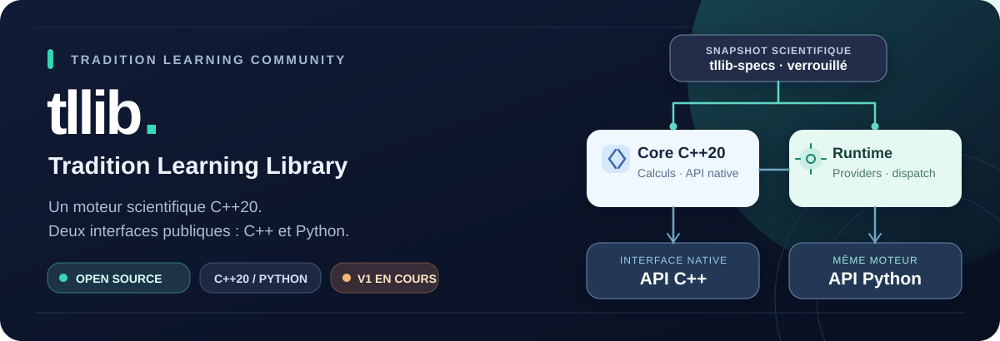
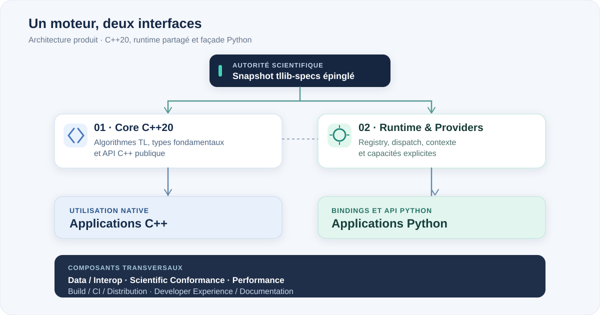

  

# tllib

**Tradition Learning Library** est la bibliothèque scientifique open source de [Tradition Learning Community ASBL](GOVERNANCE.md). Son architecture repose sur un moteur de référence **C++20**, accessible par une API C++ publique et une API Python construite sur le même moteur.

> [!IMPORTANT]
> **V1 en développement.** Les fondations natives, le runtime, les providers, l'intégration Python et les outils de conformité sont en place. Les fonctionnalités scientifiques des 36 domaines restent à réaliser et à valider. **Aucune release scientifique V1 n'est annoncée.**
>
> Les builds de qualification existants ne constituent pas une preuve de conformité du catalogue complet.

## Utiliser ou construire tllib

<table>
  <tr>
    <td width="50%" valign="top">
      <h3>◈ Utiliser la bibliothèque</h3>
      
Intégrer Tradition Learning dans un logiciel C++ ou Python, à travers les interfaces publiques. L'utilisateur n'a pas à maintenir le moteur scientifique.

      
<a href="docs/v1/PRODUCT-CONTRACT.md">Contrat produit</a> · <a href="docs/v1/CONTRIBUTOR-QUICKSTART.md">Environnement actuel</a>

    </td>
    <td width="50%" valign="top">
      <h3>◆ Contribuer au projet</h3>
      
Développer des fonctionnalités, des bindings, des tests, de l'outillage, des optimisations ou de la documentation. Chaque travail possède son périmètre et ses critères de vérification.

      
<a href="docs/v1/COMPONENTS-AND-CONTRIBUTION.md">Choisir un composant</a> · <a href="CONTRIBUTING.md">Contribuer</a>

    </td>
  </tr>
</table>

## Huit composants pour développer un seul produit

Le travail est réparti par responsabilité technique, non par nationalité, niveau d'expérience ou maîtrise simultanée de plusieurs langages.

<table>
  <tr>
    <td width="50%" valign="top"><strong>01 · ⚙️ Core C++20</strong> Calcul scientifique, types fondamentaux et <strong>API C++ publique</strong>.</td>
    <td width="50%" valign="top"><strong>02 · 🧭 Runtime &amp; Providers</strong> Registry, dispatch, contextes d'exécution et providers explicites.</td>
  </tr>
  <tr>
    <td valign="top"><strong>03 · 🐍 Python API &amp; Bindings</strong> Façade Python, bindings natifs, typage et parité.</td>
    <td valign="top"><strong>04 · 🔢 Data &amp; Interoperability</strong> ArrayView, buffers, échange mémoire et interopérabilité NumPy.</td>
  </tr>
  <tr>
    <td valign="top"><strong>05 · 🔬 Scientific Conformance</strong> Contrats verrouillés, tests d'acceptation et traçabilité.</td>
    <td valign="top"><strong>06 · ⚡ Performance &amp; Optimization</strong> Benchmarks, profilage et optimisations mesurées.</td>
  </tr>
  <tr>
    <td valign="top"><strong>07 · 📦 Build, CI &amp; Distribution</strong> CMake, pipelines, wheels et publication des versions.</td>
    <td valign="top"><strong>08 · 📚 Developer Experience &amp; Documentation</strong> Documentation des API, exemples et parcours de contribution.</td>
  </tr>
</table>

Un développeur Python peut intervenir sur l'API, les tests ou les outils sans écrire les algorithmes C++. Un développeur C++ peut contribuer au noyau sans prendre en charge la façade Python. Les changements qui traversent plusieurs composants font l'objet d'une revue commune.

**[Périmètres, dossiers, compétences et parcours →](docs/v1/COMPONENTS-AND-CONTRIBUTION.md)**

## Une architecture commune

  

Le code scientifique de référence réside en **C++20**. L'interface Python l'expose ; elle n'en crée pas une seconde implémentation. Le runtime coordonne l'exécution et les providers, sans découverte implicite de capacités.

[Architecture détaillée](docs/v1/ARCHITECTURE.md) · [Décisions techniques](docs/adr/) · [Interopérabilité numérique](docs/v1/ARRAYS-NUMERICS-CONTRACT.md)

## Le travail à réaliser

**[Explorer les issues par composant, type ou statut →](docs/v1/ISSUE-CLASSIFICATION.md)**

<table>
  <tr>
    <td align="center" width="33%"><strong>36 domaines</strong> <a href="https://github.com/Tradition-Learning-Community/tllib/issues?q=is%3Aissue+label%3Atype%3Adomain">Epics #15–#50</a></td>
    <td align="center" width="34%"><strong>178 lots</strong> <a href="https://github.com/Tradition-Learning-Community/tllib/issues?q=is%3Aissue+label%3Atype%3Atlc-fc">Issues #53–#230</a></td>
    <td align="center" width="33%"><strong>694 TLC-FC</strong> Identifiants du snapshot verrouillé</td>
  </tr>
</table>

L'[epic V1 #52](https://github.com/Tradition-Learning-Community/tllib/issues/52) coordonne l'ensemble. Trois chantiers transversaux restent ouverts : [documentation #10](https://github.com/Tradition-Learning-Community/tllib/issues/10), [distribution #11](https://github.com/Tradition-Learning-Community/tllib/issues/11) et [performance #12](https://github.com/Tradition-Learning-Community/tllib/issues/12).

L'[issue #231](https://github.com/Tradition-Learning-Community/tllib/issues/231) signale une ambiguïté normative limitée à `TLC-FC-30-EXPANSION-014` dans [#177](https://github.com/Tradition-Learning-Community/tllib/issues/177). Elle ne bloque pas les autres travaux.

## Contribuer

1. **Choisir une porte d'entrée.** [Parcours par compétence](docs/v1/COMPONENTS-AND-CONTRIBUTION.md) : C++, Python, conformité, QA, optimisation, infrastructure ou documentation.
2. **Prendre une issue précise.** Clarifier sa portée, ses dépendances et ses preuves attendues. Le label `status:ready` est attribué à une tâche effectivement qualifiée, pas à tout le backlog.
3. **Développer et tester.** Suivre le [quickstart C++/Python/outillage](docs/v1/CONTRIBUTOR-QUICKSTART.md) pour les commandes applicables.
4. **Ouvrir une pull request.** Référencer l'issue, présenter les tests réellement exécutés et signer ses commits selon le [DCO](DCO).

Une case d'acceptation n'est cochée qu'après production de la preuve correspondante. Une tâche n'est fermée que lorsque son périmètre est terminé.

## Contrats et gouvernance

Le dépôt `tllib-specs` constitue l'autorité scientifique et normative. `tllib` consomme le snapshot publié, épinglé dans [`specs.lock.json`](specs.lock.json), sans inventer de formule ou de comportement manquant. Le découpage scientifique existant est conservé.

[Licence Apache-2.0](LICENSE) · [Contributions](CONTRIBUTING.md) · [Gouvernance](GOVERNANCE.md) · [DCO](DCO) · [Sécurité](SECURITY.md) · [Critères de release V1](docs/v1/DEFINITION-OF-DONE.md)
