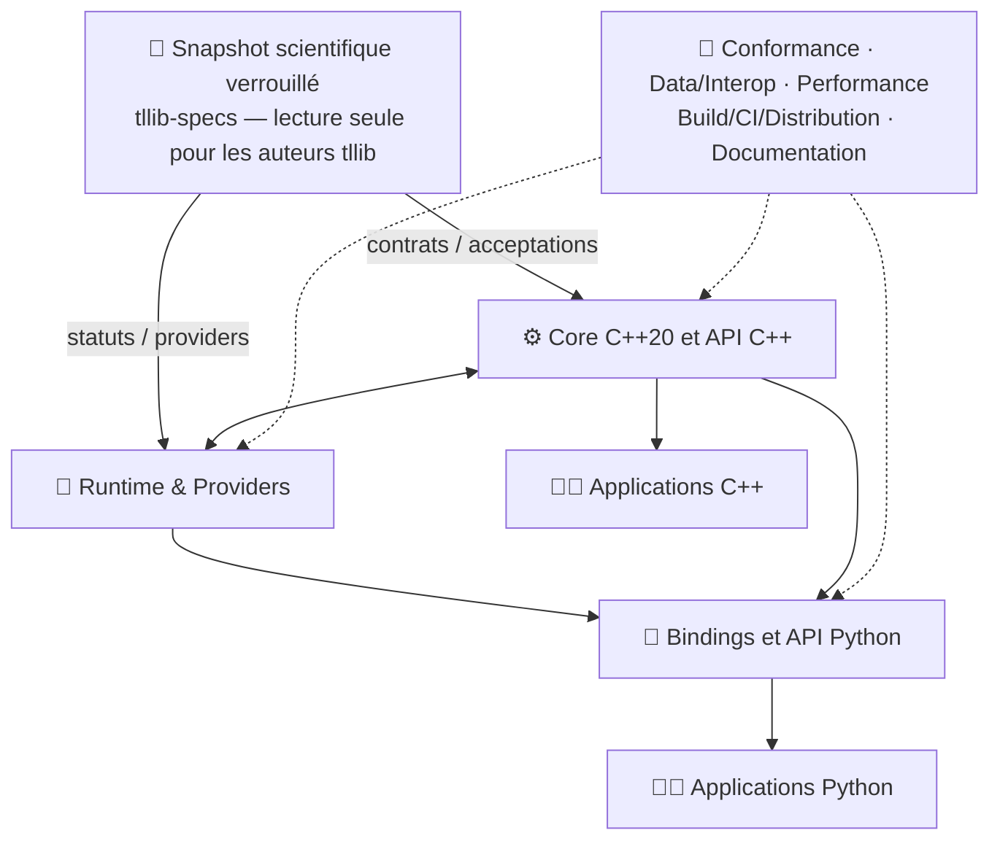

# tllib — Tradition Learning Library

**Bibliothèque scientifique open source de Tradition Learning**, développée par [Tradition Learning Community ASBL](GOVERNANCE.md). Le produit vise une **API C++20 native** et une **API Python de première classe**, toutes deux alimentées par le même moteur scientifique.

   

> **État vérifié au 31 octobre 2026 :** les fondations C++20, runtime/providers, pont Python et packaging de qualification existent ; **les fonctionnalités scientifiques des 36 domaines restent à implémenter et à valider**. Les résultats de conformité et les artefacts V1 finaux ne sont **pas** encore acquis. Ce README décrit le travail à venir, pas une release publiée.

## 👥 Deux façons de développer avec tllib

| Vous êtes… | Votre objectif | Commencer ici |
| --- | --- | --- |
| **Utilisateur / bénéficiaire** | Utiliser la bibliothèque depuis une application C++ ou Python, sans maintenir son moteur | [État du produit et installation de développement](docs/v1/CONTRIBUTOR-QUICKSTART.md), [contrat produit](docs/v1/PRODUCT-CONTRACT.md) |
| **Auteur / contributeur** | Construire le noyau, les interfaces, les tests, les performances et la distribution de tllib | [Carte des 8 composants](docs/v1/COMPONENTS-AND-CONTRIBUTION.md), [guide de contribution](CONTRIBUTING.md), [issues](../../issues) |

**Pas besoin de connaître à la fois C++ et Python pour contribuer.** Chaque tâche doit indiquer ses interfaces, dépendances, tests et compétences utiles.

## 🧩 Les huit composants de contribution

| Composant | Responsabilité | Compétences utiles |
| --- | --- | --- |
| **1. Core C++20** | Algorithmes TL, modèles, structures et **API C++ publique** | C++20, algorithmique |
| **2. Runtime & Providers** | Registry, dispatch, contexte d'exécution, providers explicites | C++, systèmes |
| **3. Python API & Bindings** | Façade Python, nanobind pour nouvelles surfaces, typage, parité | Python ; C++ pour certains bindings |
| **4. Data & Interoperability** | Vues mémoire, buffers, NumPy, DLPack si justifié | Python, C++, calcul scientifique |
| **5. Scientific Conformance** | Vérification des contrats verrouillés, acceptations, preuves | Python, tests, science |
| **6. Performance & Optimization** | Benchmarks, profiling, coût des bindings, optimisations mesurées | C++, HPC, performance |
| **7. Build, CI & Distribution** | CMake, tests automatisés, wheels, packaging, releases | CMake, DevOps, Python |
| **8. Developer Experience & Documentation** | Guides contributeurs et utilisateurs, exemples, documentation des API | Rédaction, Python, C++, QA |

Ces composants sont des **responsabilités**, pas huit dépôts, huit moteurs ou huit nouvelles hiérarchies d'issues. Ils se partagent les mêmes contrats et le même backlog.

Voir le [guide des composants](docs/v1/COMPONENTS-AND-CONTRIBUTION.md) pour les frontières, dossiers, missions autonomes et critères de validation.

## 🗺️ Où se trouve le travail ?

- **[#52 — V1](../../issues/52)** : coordination produit et critères de release ; **[#15–#50](../../issues?q=is%3Aissue+is%3Aopen+label%3Atype%3Adomain)** : 36 epics de domaines.
- **[#53–#230](../../issues?q=is%3Aissue+is%3Aopen+label%3Atype%3Atlc-fc)** : 178 lots de réalisation couvrant 694 identifiants TLC-FC, sans redécoupage scientifique.
- **[#10](../../issues/10)** documentation, **[#11](../../issues/11)** release, **[#12](../../issues/12)** performances : travaux transversaux V1 encore ouverts.
- **[#231](../../issues/231)** : une ambiguïté normative **ciblée** affecte TLC-FC-30-EXPANSION-014 (dans #177) ; elle ne bloque pas les autres lots.

**Comprendre les statuts :** une issue ouverte n'est pas nécessairement prête ; `status:ready` n'est ajouté **qu'après qualification de cette tâche**, et ne prouve pas qu'elle est terminée. L'absence de ce label ne doit pas déclencher un audit global : on qualifie les unités choisies avant de les implémenter. Les cases `[ ]` d'acceptation se cochent avec des preuves, pas avec une décision documentaire. Voir [politique de triage](docs/v1/READINESS-AND-GOVERNANCE.md).

## 🚀 Premiers pas pour les auteurs

1. Choisir son [composant et un parcours adapté](docs/v1/COMPONENTS-AND-CONTRIBUTION.md) : Python seul, C++, qualité, documentation, optimisation…
2. Ouvrir une [issue ciblée](../../issues) et vérifier son objectif, son périmètre et ses dépendances.
3. Suivre les [commandes de build/tests](docs/v1/CONTRIBUTOR-QUICKSTART.md) **applicables à son composant**.
4. Proposer une PR signée DCO, associée à l'issue, avec les tests effectivement exécutés et les critères d'acceptation démontrés.

## 🔒 Autorité scientifique et exigences

Le dépôt **tllib-specs** reste l'autorité **normative**, avec un snapshot épinglé dans [`specs.lock.json`](specs.lock.json). **Nous ne le modifions pas dans ce chantier.** `tllib` implémente les décisions publiées ; il ne fabrique ni formule manquante, ni valeur arbitraire, ni moteur scientifique Python concurrent. En présence d'une ambiguïté, seul le comportement concerné reste bloqué.

L'architecture acceptée est documentée dans [ARCHITECTURE.md](docs/v1/ARCHITECTURE.md), [PRODUCT-CONTRACT.md](docs/v1/PRODUCT-CONTRACT.md) et [les ADR](docs/adr/). La V1 ne sera déclarée livrée qu'après le [release gate](docs/v1/DEFINITION-OF-DONE.md).

**Projet et participation :** [CONTRIBUTING](CONTRIBUTING.md) · [GOVERNANCE](GOVERNANCE.md) · [LICENSE Apache-2.0](LICENSE) · [NOTICE](NOTICE) · [DCO](DCO) · [SECURITY](SECURITY.md). Les auteurs conservent leurs droits sauf accord écrit distinct.
