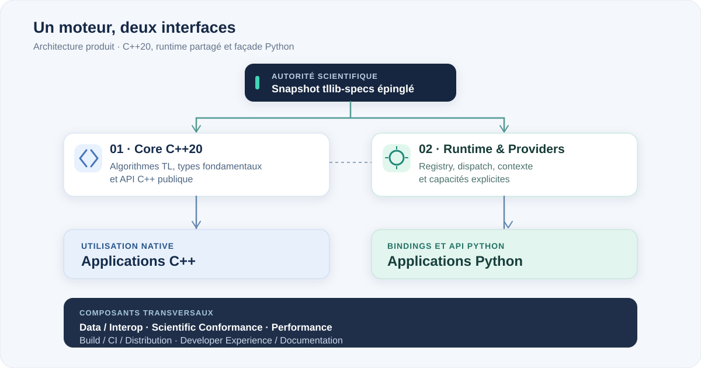

# Architecture officielle — tllib V1

## Vue générale

<p align="center">
  
</p>

Le snapshot verrouillé alimente la validation et la génération d'artefacts structurels par les outils de `tllib`. Il ne devient pas une dépendance d'exécution. La même implémentation scientifique C++20 est accessible depuis les surfaces C++ et Python ; le runtime organise les capacités et l'exécution.


## Arborescence cible

```text
tllib/
├── CMakeLists.txt
├── CMakePresets.json
├── cmake/
├── include/tllib/
│   ├── core/
│   ├── shared/
│   ├── runtime/
│   ├── providers/
│   ├── arrays/
│   └── domains/
├── src/
│   ├── core/
│   ├── shared/
│   ├── runtime/
│   ├── providers/
│   ├── arrays/
│   └── domains/
├── generated/specs/
├── bindings/python/
│   ├── pyproject.toml
│   ├── CMakeLists.txt
│   ├── src/
│   ├── tllib/
│   └── tests/
├── tools/
│   ├── specgen/
│   ├── conformance/
│   └── migration/
├── prototypes/python/
├── tests/
│   ├── cpp/unit/
│   ├── cpp/integration/
│   ├── cpp/conformance/
│   └── fixtures/
├── benchmarks/
├── fuzz/
├── docs/
├── specs.lock.json
└── LICENSE
```

## Dépendances entre couches

- `core` ne dépend d'aucun domaine ni de Python.
- `shared` ne contient aucune sémantique de domaine.
- `runtime` orchestre registry, dispatch et contexte d'exécution.
- `providers` définit des ports explicites, sans intégration cachée.
- les domaines dépendent seulement des couches autorisées.
- les bindings Python ne contiennent pas la logique scientifique de référence.
- `tools/specgen` peut être Python mais n'est jamais une dépendance runtime.

## Modèle objet et ownership

- POO dès V1, composition et value objects avant héritage profond.
- types fondamentaux immuables ou invariant-safe.
- polymorphisme uniquement aux points de variation réels.
- RAII partout.
- `std::unique_ptr` par défaut pour ownership dynamique.
- `std::shared_ptr` seulement si le partage de durée de vie est intrinsèque.
- vues non-owning pour buffers et entrées.
- PImpl possible pour surfaces publiques à volatilité/ABI sensible.

## Arrays et calcul numérique

`tllib` ne crée pas un nouvel ndarray généraliste.

Le cœur définit une vue minimale et indépendante de Python avec au minimum :
data/handle, dtype, shape, strides, device et mutability.

Interopérabilité :
- NumPy/buffer protocol côté Python ;
- DLPack lorsque pertinent ;
- zéro copie lorsque layout et lifetime le permettent ;
- copie explicite sinon.

Les backends numériques sont choisis après inventaire des besoins des 36
domaines. BLAS/LAPACK/FFT/etc. ne sont pas réimplémentés sans raison propre à TL.

## Runtime, registry et providers

Le runtime contient :
- mapping TLC-FC -> statut/version/provenance/implémentation ;
- dispatcher explicite ;
- contrôle de version de specs ;
- résolution explicite des providers ;
- diagnostics structurés.

Aucun scan magique, aucun enregistrement par effet de bord, aucun provider
scientifique implicite, aucun appel réseau caché.

## Erreurs et concurrence

- erreurs attendues : `Result<T>` + erreur structurée ;
- exceptions réservées aux erreurs exceptionnelles/programming failures ;
- aucune exception à travers une future ABI C ;
- pas de donnée globale mutable non protégée ;
- `ExecutionContext` explicite pour cancellation, executor, device et options ;
- pas de thread pool global caché.

## Intégration tllib-specs

`specs.lock.json` épingle un snapshot immuable.
`specgen` lit uniquement le handoff publié, génère seulement des structures et
métadonnées déterministes, et inscrit la provenance du SHA.

La CI régénère ces artefacts et exige zéro diff.

## Python

Python sert à :
- API utilisateur ;
- interop NumPy ;
- providers Python ;
- tooling ;
- tests ;
- prototypes ;
- documentation.

Le choix du binder est désormais accepté dans [ADR-004](../adr/ADR-004-python-bindings.md) : **nanobind pour les nouvelles surfaces**, tandis que le pont CPython natif existant reste en place pour les providers. L'architecture conserve un moteur scientifique C++20 unique.

## Organisation des auteurs de tllib

Les huit **composants de contribution** (Core C++20 et API C++, Runtime & Providers, Python API & Bindings, Data & Interoperability, Scientific Conformance, Performance & Optimization, Build/CI/Distribution, Developer Experience & Documentation) décrivent les responsabilités humaines au sein des couches ci-dessus ; ils ne créent pas de nouveaux modules normatifs ni de moteurs séparés. Voir [la carte des composants](COMPONENTS-AND-CONTRIBUTION.md).

## CI et release

La CI est progressive :
- PR fast : build/tests impactés ;
- PR native : toolchain/sanitizers ciblés ;
- main : plateformes principales ;
- nightly : matrices larges, fuzz, full conformance, benchmarks ;
- release : artefacts complets et smoke tests installés.

Aucune matrice cartésienne complète n'est exécutée à chaque commit.
