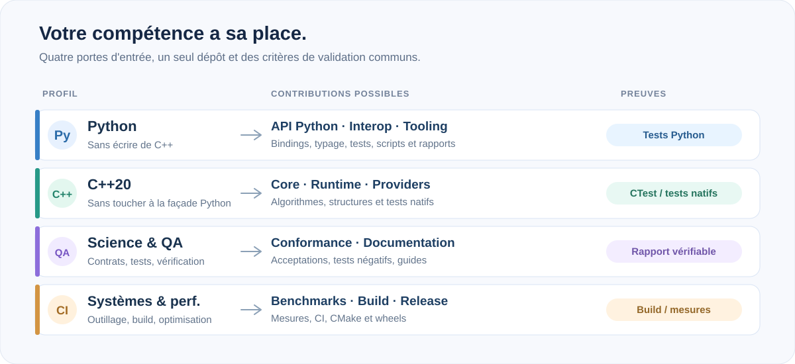
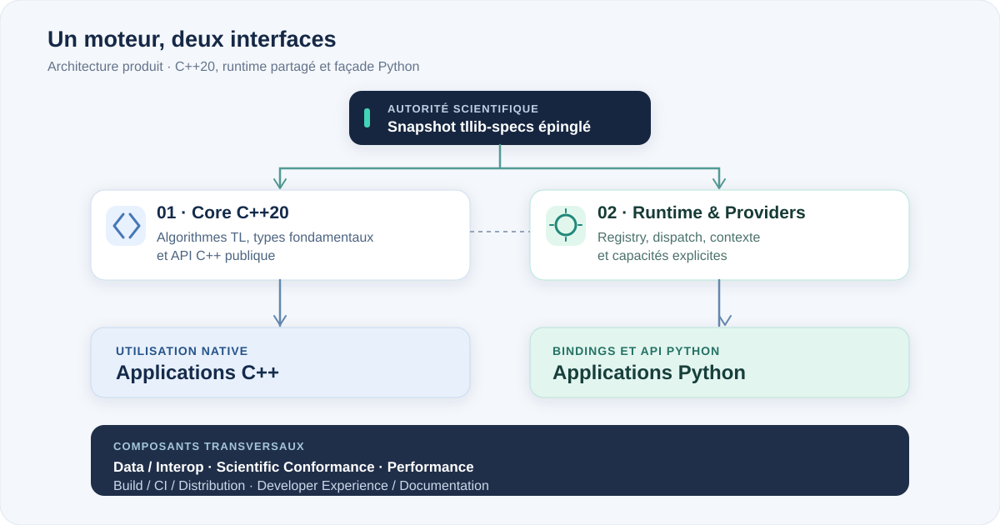

# Les composants de contribution

**Huit responsabilités, un dépôt, une bibliothèque.** Cette carte s'adresse aux auteurs de `tllib` : elle précise où intervenir, avec quelles compétences et sur quelles preuves conclure une contribution.

Elle n'ajoute ni nouvelles branches scientifiques ni seconde architecture. Les domaines et les lots TLC-FC restent organisés dans les issues existantes.

  

[**Rechercher les issues par composant, type et disponibilité →**](ISSUE-CLASSIFICATION.md)

## Trouver sa place

| Vous maîtrisez… | Travaux possibles | Point d'entrée |
| --- | --- | --- |
| **Python** | API utilisateur, tests, typage, outils de conformité, interop NumPy | [Python](#03--python-api--bindings), [interopérabilité](#04--data--interoperability), [conformité](#05--scientific-conformance) |
| **C++20** | Calcul scientifique, structures, runtime, providers, tests natifs | [Core](#01--core-c20), [Runtime](#02--runtime--providers) |
| **Mathématiques, QA ou documentation** | Acceptations, tests négatifs, exemples, documentation des API | [Conformité](#05--scientific-conformance), [documentation](#08--developer-experience--documentation) |
| **Performance, systèmes ou CI** | Profilage, optimisation, build, packaging, portabilité | [Performance](#06--performance--optimization), [distribution](#07--build-ci--distribution) |

Une compétence est un point d'entrée, non une frontière absolue. Une tâche nécessitant plusieurs spécialités précise les composants associés et les relectures requises.

## Carte du produit

  

Le **Core** porte les opérations scientifiques et l'API C++ ; le **runtime** organise l'exécution ; les **bindings** exposent ce même moteur en Python. Les cinq autres composants traversent ces couches. Les règles de dépendance et les contrats d'interface figurent dans [l'architecture officielle](ARCHITECTURE.md).

## Les huit composants

### 01 · Core C++20

**Mission.** Implémenter en C++20 les fonctionnalités TLC-FC exécutables, les types fondamentaux et les surfaces publiques C++ nécessaires.

**Où intervenir.** `include/tllib/core/`, `include/tllib/shared/`, `tests/cpp/` ; `include/tllib/domains/` et `src/domains/` sont des emplacements cibles pour les réalisations scientifiques.

**Preuves.** Tests natifs, conformité aux acceptations concernées, respect des invariants, API C++ utilisable par un consommateur externe.

### 02 · Runtime & Providers

**Mission.** Enregistrer les capacités, résoudre explicitement les providers et piloter les appels à travers le contexte d'exécution.

**Où intervenir.** `include/tllib/runtime/`, `include/tllib/providers/`, tests du runtime et des providers.

**Preuves.** Dispatch vérifié, erreurs structurées, refus explicite lorsqu'un provider manque, durée de vie et concurrence maîtrisées.

### 03 · Python API & Bindings

**Mission.** Fournir une API Python cohérente et typée au-dessus du moteur natif, avec parité de comportement quand une même opération existe en C++.

**Où intervenir.** `bindings/python/`, `tests/python/`, stubs `.pyi` et `py.typed`.

**Preuves.** Installation de la wheel de qualification, import, tests Python, parité et gestion correcte des erreurs. **Les wrappers, stubs, tests et outils Python ne nécessitent pas tous une contribution C++** ; les changements du binding natif appellent une revue C++.

**Décision technique.** [ADR-004](../adr/ADR-004-python-bindings.md) retient nanobind pour les nouvelles surfaces ; le pont CPython existant reste en place pour les providers.

### 04 · Data & Interoperability

**Mission.** Assurer le passage de données entre C++ et Python, avec des règles explicites de type, de forme, de strides, de propriété mémoire et de copie.

**Où intervenir.** Primitives natives, `bindings/python/`, tests de buffers, [contrat numérique](ARRAYS-NUMERICS-CONTRACT.md).

**Preuves.** Durée de vie des vues, zéro-copie lorsque valide, copie explicite sinon, tests de layouts et erreurs de conversion. L'intégration DLPack n'est retenue que lorsqu'elle répond à un besoin démontré.

### 05 · Scientific Conformance

**Mission.** Vérifier la fidélité de l'implémentation au snapshot scientifique épinglé. Distinguer correctement `executable`, `conditionally_executable` et `structural_only`.

**Où intervenir.** `specs.lock.json`, `conformance/`, `tools/specs_pipeline.py`, `tests/specs/`.

**Preuves.** Cas positifs et négatifs traçables, rapports reproductibles, provenance du snapshot, évolution des décisions uniquement lorsqu'une fonctionnalité est effectivement validée.

### 06 · Performance & Optimization

**Mission.** Mesurer les coûts des opérations natives, du runtime et des bindings avant d'optimiser.

**Où intervenir.** [Issue #12](https://github.com/Tradition-Learning-Community/tllib/issues/12), bancs de mesure et tests de non-régression ; `benchmarks/` est une cible de travail.

**Preuves.** Scénarios représentatifs, baselines et mesures reproductibles. Une amélioration de performance ne peut modifier silencieusement un résultat scientifique ni introduire une tolérance arbitraire.

### 07 · Build, CI & Distribution

**Mission.** Compiler, tester et distribuer une bibliothèque native et des packages Python liés au même commit et au même snapshot.

**Où intervenir.** `CMakeLists.txt`, `cmake/`, `.github/workflows/`, `pyproject.toml`, [issue #11](https://github.com/Tradition-Learning-Community/tllib/issues/11).

**Preuves.** Build propre, consommation CMake externe, installation de wheel, tests des artefacts, plateformes réellement qualifiées et provenance de release.

### 08 · Developer Experience & Documentation

**Mission.** Permettre aux utilisateurs de comprendre la bibliothèque et aux contributeurs de travailler sans accompagnement oral.

**Où intervenir.** `README.md`, `CONTRIBUTING.md`, `docs/`, `.github/ISSUE_TEMPLATE/`, [issue #10](https://github.com/Tradition-Learning-Community/tllib/issues/10).

**Preuves.** Guides exacts, liens valides, commandes et exemples testés lorsque pertinents, statut des fonctionnalités généré depuis les données de conformité plutôt que recopié à la main.

## Une issue, un travail identifiable

| Type d'issue | Rôle | Action du contributeur |
| --- | --- | --- |
| [#52](https://github.com/Tradition-Learning-Community/tllib/issues/52) | Coordination de la V1 | Suivre les objectifs et le gate de release |
| [#15–#50](https://github.com/Tradition-Learning-Community/tllib/issues?q=is%3Aissue+label%3Atype%3Adomain) | 36 domaines | Comprendre le périmètre et les dépendances |
| [#53–#230](https://github.com/Tradition-Learning-Community/tllib/issues?q=is%3Aissue+label%3Atype%3Atlc-fc) | 178 lots TLC-FC | Qualifier puis réaliser un lot précisément défini |
| [#10](https://github.com/Tradition-Learning-Community/tllib/issues/10) / [#11](https://github.com/Tradition-Learning-Community/tllib/issues/11) / [#12](https://github.com/Tradition-Learning-Community/tllib/issues/12) | Documentation, release, performance | Réaliser des livrables transversaux |

Le découpage de référence compte **694 TLC-FC**. Les huit composants sont un moyen de se répartir ce travail, **pas un nouveau backlog scientifique**. Ne pas ouvrir une issue supplémentaire lorsqu'une tâche existante couvre déjà le livrable.

### Prendre une issue

1. **Lire le périmètre.** Identifier ce qui doit être livré et ce qui est explicitement exclu.
2. **Vérifier les dépendances.** Pour une TLC-FC : statut, opération, entrées/sorties, erreurs, providers et acceptations du snapshot verrouillé. Pour une tâche non scientifique, ces éléments sont sans objet.
3. **Qualifier la tâche.** Utiliser `status:ready` lorsque le travail est autonome et que les décisions nécessaires sont acquises. Ne pas attribuer ce label en masse.
4. **Implémenter et démontrer.** Ajouter les tests correspondant aux changements et fournir les commandes exécutées.
5. **Faire relire et conclure.** Obtenir les revues adaptées ; cocher les critères seulement avec preuve ; fermer l'issue uniquement lorsqu'elle est entièrement traitée.

Un blocage ne doit toucher que le travail concerné. [#231](https://github.com/Tradition-Learning-Community/tllib/issues/231) reste limité à `TLC-FC-30-EXPANSION-014` au sein du lot [#177](https://github.com/Tradition-Learning-Community/tllib/issues/177).

## Vérification et règles communes

- **Science.** `tllib-specs` est l'autorité normative. Le snapshot est verrouillé par `specs.lock.json`. Aucune formule, constante ou tolérance n'est improvisée dans `tllib`.
- **Une seule implémentation de référence.** Les algorithmes scientifiques sont natifs ; Python expose ce moteur et fournit ses outils.
- **Tests adaptés.** Un changement documentaire n'exige pas de compilation C++ artificielle. Une contribution native exige les tests natifs pertinents. Les tests déclarés sont ceux réellement exécutés.
- **Conformité.** Les tests de catalogue ne prouvent pas, à eux seuls, l'implémentation des 694 TLC-FC.
- **Revue.** Une PR référence sa tâche, ses dépendances et ses preuves, et respecte le [DCO](../../DCO).

**Pour travailler :** [commandes de démarrage](CONTRIBUTOR-QUICKSTART.md) · [triage des issues](READINESS-AND-GOVERNANCE.md) · [revue et fusion](REVIEW-AND-MERGE.md) · [critères V1](DEFINITION-OF-DONE.md).
