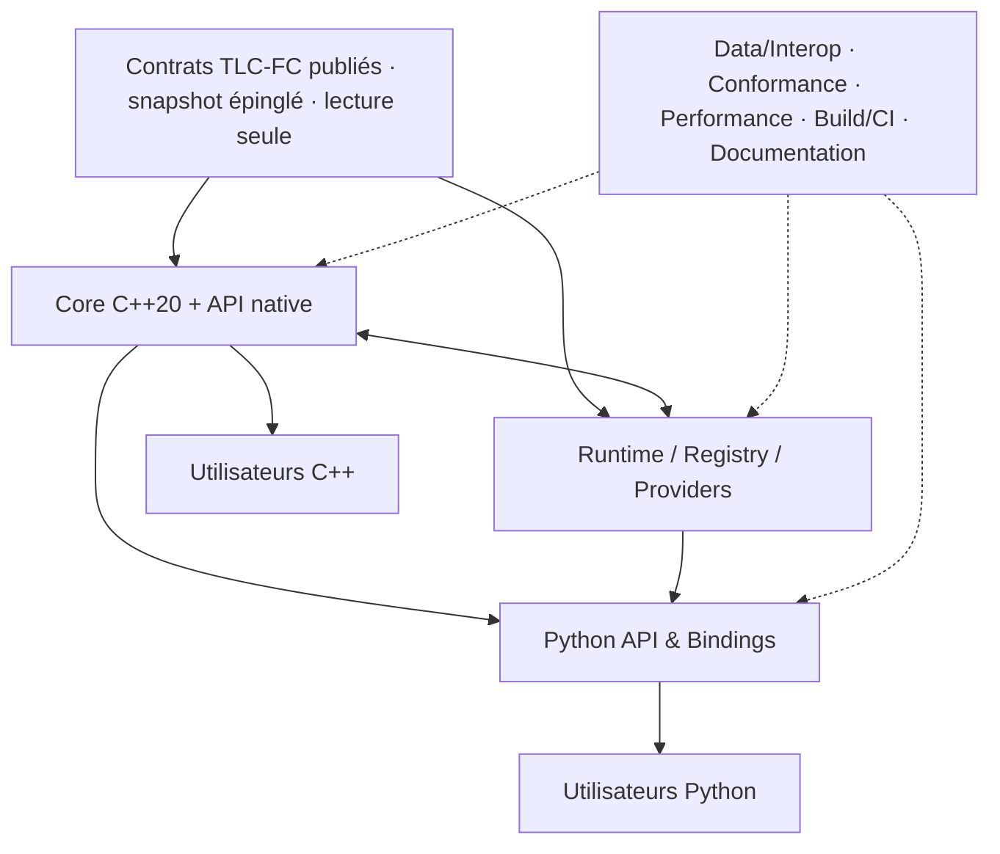
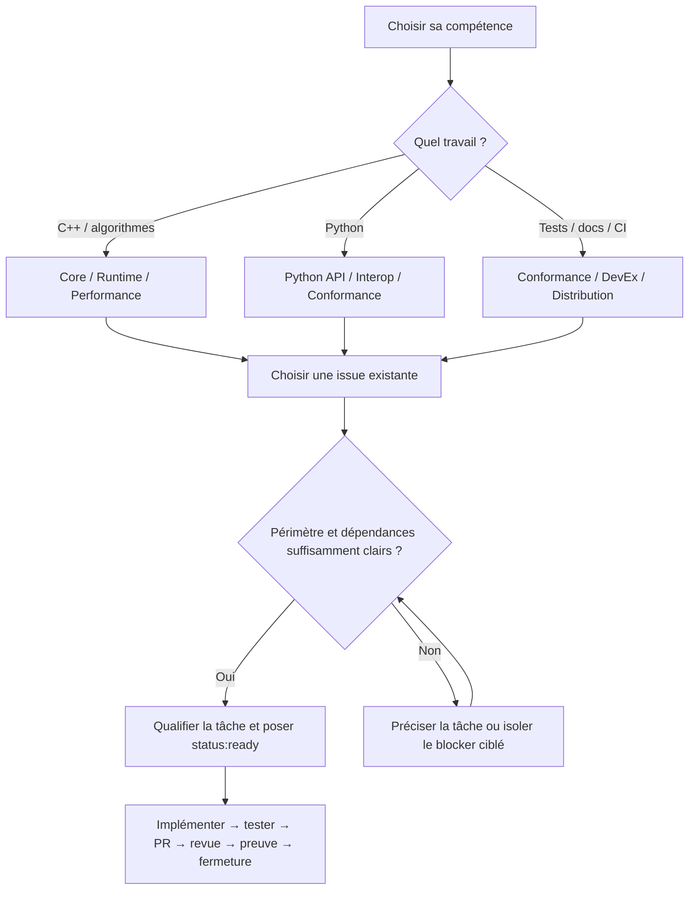

# 🧩 Carte des composants et parcours de contribution — tllib V1

> **Document opérationnel pour les auteurs de tllib.** Les composants servent à répartir les compétences, **pas** à créer huit sous-projets ni huit moteurs indépendants. Les 36 domaines et 178 lots TLC-FC gardent leur découpage autoritaire. Dernier état de référence : préparation close au 31 octobre 2026, implémentation scientifique V1 à réaliser.

## 1. 👤 Utilisateur ou auteur ?

- **Utilisateur / bénéficiaire** : intègre l'API C++ ou Python dans une application. Il ne doit ni compiler le moteur scientifique depuis ses sources pour l'utiliser après release, ni maîtriser la logique interne.
- **Auteur / contributeur** : construit, vérifie, optimise et distribue cette même bibliothèque. Une personne peut travailler sur la façade Python, les tests ou la documentation **sans maîtriser C++** ; une autre peut contribuer au moteur C++ **sans développer la façade Python**.

## 2. 🏗️ Une architecture, des contributions indépendantes

Le code scientifique normatif **n'est jamais dupliqué en Python**. L'API C++ est une surface publique du Core, pas un neuvième groupe. Les interfaces et leurs évolutions sont gouvernées par les documents [d'architecture](ARCHITECTURE.md) et [ADR](../adr/).

## 3. 📦 Périmètre et premier point d'entrée

| Composant | Vous pouvez contribuer à… | Repères actuels | Vérifier avant de fermer |
| --- | --- | --- | --- |
| ⚙️ **Core C++20** | opérations TLC-FC exécutables, types et erreurs, API C++ | `include/tllib/core/`, `include/tllib/shared/`, futurs `include/tllib/domains/`, `src/domains/`, `tests/cpp/` | tests natifs, acceptations des TLC-FC, invariants |
| 🧭 **Runtime & Providers** | registre, dispatch, contextes, refus explicite d'exécution impossible | `include/tllib/runtime/`, `include/tllib/providers/`, tests runtime | diagnostics, absence de provider implicite, lifetime |
| 🐍 **Python API & Bindings** | API typée, bindings, erreurs cohérentes et parité C++/Python | `bindings/python/`, `tests/python/`; [ADR-004](../adr/ADR-004-python-bindings.md) | wheel/import, stubs, comportement identique et tests Python |
| 🔢 **Data & Interoperability** | ArrayView, buffers, copies explicites, échanges NumPy/DLPack pertinents | `include/tllib/core/`, `bindings/python/`, [contrat numérique](ARRAYS-NUMERICS-CONTRACT.md) | dtype/shape/strides, propriété mémoire, zéro-copie prouvée |
| 🔬 **Scientific Conformance** | lecture du lock, rapports, cas négatifs, alignement des acceptations | `specs.lock.json`, `conformance/`, `tools/specs_pipeline.py`, `tests/specs/` | statut réel de chaque TLC-FC, provenance, résultats reproductibles |
| ⚡ **Performance & Optimization** | benchmarks, profiling, mémoire, allocations, coût bindings | `benchmarks/` lorsque présent ; [#12](https://github.com/Tradition-Learning-Community/tllib/issues/12) | mesures reproductibles, pas de régression scientifique |
| 📦 **Build, CI & Distribution** | CMake, tests installés, wheels, pipelines et release | `CMakeLists.txt`, `cmake/`, `.github/workflows/`, `pyproject.toml`; [#11](https://github.com/Tradition-Learning-Community/tllib/issues/11) | build propre, artefacts testés, plateformes effectivement qualifiées |
| 📚 **Developer Experience & Documentation** | parcours auteurs et utilisateurs, exemples, docs générées, accessibilité | `README.md`, `CONTRIBUTING.md`, `docs/`, `.github/ISSUE_TEMPLATE/`; [#10](https://github.com/Tradition-Learning-Community/tllib/issues/10) | liens, commandes, exemples vérifiés ; pas de statut inventé |

*Ces chemins sont des repères, et certains sont cibles plutôt que déjà remplis. Une tâche transverse peut traverser plusieurs composants : il faut alors annoncer sa surface principale et les relectures nécessaires.*

## 4. 🧭 Trouver une tâche sans se perdre

**Hiérarchie à conserver :** [#52](https://github.com/Tradition-Learning-Community/tllib/issues/52) coordonne la V1 ; **#15–#50** suivent les domaines ; **#53–#230** sont les 178 lots TLC-FC. Les issues #10/#11/#12 portent des livrables transversaux. Une mission supplémentaire n'est créée que lorsqu'aucune issue existante ne couvre son résultat. Ne pas dupliquer une TLC-FC sous une nouvelle issue simplement pour représenter un composant.

**Qualification locale (pas une nouvelle phase de préparation globale)** : identifier le ou les IDs, statut d'exécution, opérations, entrées/sorties, erreurs, providers, acceptations et tests. Pour une tâche non scientifique, les champs TLC-FC sont *sans objet*. **Ne pas attribuer `status:ready` en masse** et ne pas cocher des tests non exécutés.

## 5. ✅ Définition de terminé pour une contribution

- [ ] Le périmètre de l'issue est traité ; les dépendances et surfaces touchées sont documentées.
- [ ] Les comportements sont conformes aux contrats réellement applicables, sans nouvelle science implicite.
- [ ] Les cas positifs **et négatifs** ont des tests adaptés ; la PR cite les commandes réellement exécutées.
- [ ] La compatibilité C++/Python est vérifiée **si** les deux surfaces sont exposées.
- [ ] Les résultats de conformité/provenance sont mis à jour si la tâche concerne des TLC-FC.
- [ ] Les nouveaux API, limites et exemples sont documentés lorsque pertinents.
- [ ] La revue est faite, les sign-offs DCO sont présents, et tous les critères de fermeture propres à l'issue sont satisfaits.

Les cases représentent des **preuves à produire**, non un état courant du dépôt. Les tâches de documentation n'ont pas besoin de tests C++ artificiels ; les tâches C++ ne peuvent pas se dispenser de tests natifs.

## 6. ⚖️ Frontières non négociables

- `tllib-specs` reste la source scientifique normative ; **aucun changement de ce dépôt n'est inclus ici**.
- `tllib` consomme seulement le snapshot épinglé. Une ambiguïté normative ne se résout pas dans une PR logicielle.
- Le blocker [#231](https://github.com/Tradition-Learning-Community/tllib/issues/231) concerne **TLC-FC-30-EXPANSION-014** dans #177, pas les autres domaines.
- Le choix de binder est acté : **nanobind pour les nouvelles surfaces**, pont CPython existant conservé pour les providers ([ADR-004](../adr/ADR-004-python-bindings.md)).
- Le package V1, la couverture scientifique et la qualification multi-plateforme ne doivent jamais être déduits d'un simple build vert.

**Guides pratiques :** [quickstart vérifiable](CONTRIBUTOR-QUICKSTART.md), [gouvernance des issues](READINESS-AND-GOVERNANCE.md), [revue et fusion](REVIEW-AND-MERGE.md), [définition de terminé V1](DEFINITION-OF-DONE.md).
