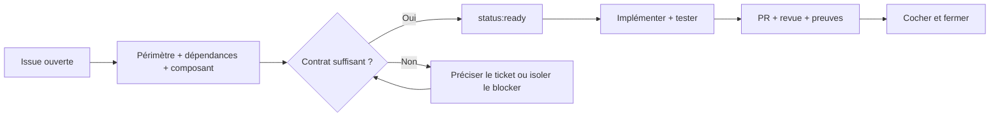

# Classer et suivre les issues de tllib

> **Règles de triage V1.** Les labels permettent à un contributeur de trouver un travail par compétence, nature et état. Ils ne modifient ni les contrats scientifiques ni les critères de validation.

## Trois questions différentes

| Question | Métadonnée | Exemple |
| --- | --- | --- |
| **Quel travail ?** | Un seul `type:*` | `type:tlc-fc`, `type:task`, `type:domain` |
| **Dans quel composant ?** | Un ou plusieurs `component:*` | `component:core`, `component:python` |
| **Où en est-il ?** | `status:ready` ou `status:blocked` si justifié | Sans statut = **à qualifier**, pas « bloqué » |

Les labels `area:*` existants restent des **repères de technologie ou de surface**. Ils complètent `component:*` ; ils ne doivent pas être supprimés en bloc. Une issue peut toucher plusieurs composants, mais son périmètre doit rester identifiable.

### Les huit composants

| Label | Responsabilité | Issues ou repères |
| --- | --- | --- |
| `component:core` | Core C++20, calcul TL, structures, API C++ | Epics #15–#50, lots #53–#230 |
| `component:runtime` | Exécution, registry, dispatch, providers | Fondations #238, #239 ; tâches runtime futures |
| `component:python` | API Python, bindings, typage, parité | Fondation #242 ; travaux Python explicités dans les lots |
| `component:interop` | Arrays, buffers, NumPy, échange mémoire | Fondation #236 ; sous-travaux interopérabilité |
| `component:conformance` | Acceptations, tests, provenance, rapports, blockers de conformité | #241, #231 ; lots à forte dominante structurelle |
| `component:performance` | Benchmarks et optimisations mesurées | #12 |
| `component:build` | Build, CI, CMake, wheels, release | #11 |
| `component:docs` | Guides, API docs, exemples et expérience développeur | #10 |

Les epics scientifiques et les lots de codage portent `component:core` comme **repère principal de réalisation**. Ce label **n'affirme pas** que chaque TLC-FC exige un calcul natif, ni que Python ou la conformité sont hors périmètre. Selon les contrats applicables, on ajoute `component:python`, `component:runtime`, `component:interop` ou `component:conformance` **lorsque leur contribution est concrète**. La qualification du lot décide des travaux et des tests ; son label ne décide pas de la science.

Les labels affectés aux fondations clôturées servent aussi à retrouver l'historique des choix. **Ne pas rouvrir ces fondations** pour avoir une issue par composant.

## Filtres GitHub : trouver un travail

Les liens montrent des **issues ouvertes**, pas nécessairement des tâches immédiatement prêtes.

| Périmètre | Ouvrir |
| --- | --- |
| Tous les lots scientifiques | [178 lots TLC-FC](https://github.com/Tradition-Learning-Community/tllib/issues?q=is%3Aissue+is%3Aopen+label%3Atype%3Atlc-fc) |
| Domaines de réalisation | [36 epics domaine](https://github.com/Tradition-Learning-Community/tllib/issues?q=is%3Aissue+is%3Aopen+label%3Atype%3Adomain) |
| Travaux liés au Core | [Core C++20](https://github.com/Tradition-Learning-Community/tllib/issues?q=is%3Aissue+is%3Aopen+label%3Acomponent%3Acore) |
| Travaux Python | [Python API & Bindings](https://github.com/Tradition-Learning-Community/tllib/issues?q=is%3Aissue+is%3Aopen+label%3Acomponent%3Apython) |
| Validation scientifique | [Scientific Conformance](https://github.com/Tradition-Learning-Community/tllib/issues?q=is%3Aissue+is%3Aopen+label%3Acomponent%3Aconformance) |
| Documentation | [Developer Experience](https://github.com/Tradition-Learning-Community/tllib/issues?q=is%3Aissue+is%3Aopen+label%3Acomponent%3Adocs) |
| Performances | [Performance & Optimization](https://github.com/Tradition-Learning-Community/tllib/issues?q=is%3Aissue+is%3Aopen+label%3Acomponent%3Aperformance) |
| Distribution | [Build, CI & Distribution](https://github.com/Tradition-Learning-Community/tllib/issues?q=is%3Aissue+is%3Aopen+label%3Acomponent%3Abuild) |
| Tâches effectivement qualifiées | [`status:ready`](https://github.com/Tradition-Learning-Community/tllib/issues?q=is%3Aissue+is%3Aopen+label%3Astatus%3Aready) |
| Bloqueurs justifiés | [`status:blocked`](https://github.com/Tradition-Learning-Community/tllib/issues?q=is%3Aissue+is%3Aopen+label%3Astatus%3Ablocked) |

Tous les composants ne possèdent pas encore une **issue ouverte dédiée**. C'est normal : plusieurs fondations sont terminées et la population actuelle est principalement composée de lots scientifiques. Une nouvelle tâche Python, runtime ou interopérabilité doit apporter un résultat autonome, **pas répéter la directive du lot parent**.

## Qualifier puis réaliser

- Les issues de domaine **coordonnent** ; les lots **réalisent**. L'epic #52 suit le produit.
- Pour une TLC-FC, partir du snapshot épinglé : statut d'exécution, opérations, entrées/sorties, erreurs, providers, acceptations et surfaces publiques.
- N'ajouter `status:ready` qu'après examen du **travail précis** ; ne pas marquer les 178 lots en masse.
- `status:blocked` exige une cause et un périmètre documentés. #231 concerne seulement `TLC-FC-30-EXPANSION-014` dans #177 ; les autres fonctionnalités ne sont pas bloquées par association.
- Une issue sans `status:ready` ni `status:blocked` reste **à qualifier**. Cela ne signifie ni démarrage interdit par principe, ni conformité acquise.
- Les cases des checklists se cochent avec les **preuves réelles** (tests, artefacts, comportements), jamais parce qu'un label a changé.

## Milestones et Project

**Ne pas multiplier les outils de suivi :** les jalons (milestones) servent à une **date ou un objectif de livraison commun** ; un Project sert à visualiser le flux de travail à travers les composants. Ils ne doivent pas redire `type:*`, `component:*` ou `status:*` sans bénéfice concret.

La décision de gouvernance #261 n'imposait aucun milestone pour commencer. **Aucun jalon supplémentaire n'est nécessaire pour classer les 219 issues ouvertes**. Si un vrai jalon de release est décidé, utiliser **un seul jalon V1** pour les issues dont la fermeture est une condition de livraison ; ne pas créer un milestone par composant, par domaine ou par lot. Le suivi quotidien peut rester dans la page Issues avec les filtres ci-dessus.

Un **GitHub Project** pourra être utile lorsqu'il faudra coordonner des mainteneurs et plusieurs contributeurs simultanément : colonnes `À qualifier`, `Prêt`, `En cours`, `En revue`, `Terminé`, vues filtrées par composant. Il restera **une vue**, non une deuxième source de vérité scientifique ou un backlog parallèle. Ne pas le créer tant qu'il n'a pas de mainteneur et de routine de mise à jour.

**Références :** [carte des composants](COMPONENTS-AND-CONTRIBUTION.md) · [gouvernance](READINESS-AND-GOVERNANCE.md) · [revue](REVIEW-AND-MERGE.md) · [définition de terminé](DEFINITION-OF-DONE.md).
